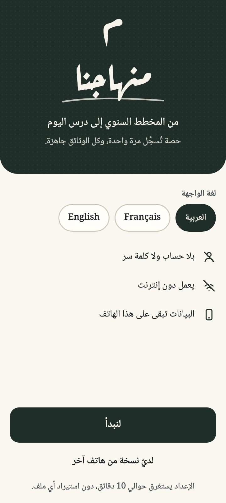

# Minhajna · منهاجنا

من التدرّج إلى الحصّة · From the yearly plan to every lesson

<table>
  <tr>
    <td align="center" valign="top"> الترحيب Welcome</td>
    <td align="center" valign="top"> تأكيد الحصة بلمسة Today, one tap</td>
    <td align="center" valign="top"> المناداة Roll call</td>
    <td align="center" valign="top"> دفتر النصوص The texts book</td>
  </tr>
</table>

تصاميم أولية، والأسماء فيها وهمية. <a href="docs/design/screens.md">كل الشاشات</a>

Draft designs; all names are made up. <a href="docs/design/screens.md">See all the screens</a>.

**العربية** · [English](#english)

**«منهاجنا»** تطبيق مجاني ومفتوح المصدر لأساتذة الجزائر. يجمع في مكان واحد دفتر النصوص والكراس اليومي ودفتر المناداة ودفتر التنقيط، ويربطها كلها بالحصة. في كل حصة، يقترح لكل قسم الدرسَ المقرّر حسب التدرّج الرسمي، فيؤكّد الأستاذ ما أنجزه بلمسة واحدة بدل أن يكتبه، وتُملأ الدفاتر من ذلك. يعمل على الهاتف دون إنترنت، ويطبع ما يطلبه المدير والمفتش.

**هدفنا:** أن تعتمد وزارة التربية الوطنية «منهاجنا» سجلًّا رسميًا رقميًا للتدريس، وتشغّله على خوادمها منظومةً وطنية واحدة، مع حماية مبنيّة في تصميمه نفسه: من يشغّل الخوادم لا يستطيع قراءة أي سجل يحمل اسمًا. وإلى ذلك الحين، يبقى أداة في يد الأستاذ وحده.

> **المشروع قيد التطوير، ولم يُنشر أي تطبيق بعد.** في المستودع اليوم النواة المشتركة ونسخة أولية لأندرويد، وتجد ما نعمل عليه الآن في [خطة التجربة الميدانية](https://github.com/djazairdev/minhajna/issues/49). كان اسم المشروع «طباشير» حتى أكتوبر 2026، وأي تطبيق يحمل أحد الاسمين اليوم ليس تطبيقنا.

### مبادئنا

1. **العلنية هي الأصل:** الكود والوثائق والقرارات وخارطة الطريق علنية كلها منذ السطر الأول.
2. **معطيات التلاميذ لا تصل إلى المشروع أبدًا.** تبقى على أجهزة الأستاذ، وفي المنظومة الوطنية تُحفظ مشفّرة في فضاء المؤسسة. والمزامنة والنسخ الاحتياطي مشفّران من طرف إلى طرف.
3. **لا إشهار ولا متتبعات، ولا بيع للمعطيات ولا مشاركتها، أبدًا.**
4. **مجاني، ولا يُباع أبدًا:** كل ما يقدّمه «منهاجنا» مجاني للأساتذة وللدولة، والمشروع لا يبيع شيئًا.
5. **الكود علني، وسجلات الأساتذة خاصة:** فوق المؤسسة لا تظهر إلا مجاميع، بشرط أن تبلغ كل مجموعة الحدّ الأدنى المعلَن.
6. **مبنيّ ليصبح السجل الرسمي، لا من تلقاء نفسه:** لا يصير رسميًا إلا بنصّ مكتوب من السلطة المختصة، وإلى ذلك الحين هو أداة في يد الأستاذ.
7. **الأستاذ يملك سجلات عمله:** يصدّرها كاملة ومجانًا متى شاء، وملاحظاته الخاصة لا تغادر أجهزته.
8. **البناء علنًا، والعربية أولًا.**

### ميثاق استعمال البيانات

عشرة بنود تحمي الأساتذة الذين تُحفظ سجلاتهم في «منهاجنا»: لا تُستعمل السجلات في المسار المهني، ولا مراقبة، ويُصحَّح الخطأ بدل قفل السجل، ويرى الأستاذ كل ما يراه المدير، ولا يظهر فوق المؤسسة إلا مجاميع. سنطلب من الوزارة أن تعتمد الميثاق في نصّها، وسيُعرض على أساتذة كل مؤسسة قبل الإطلاق الوطني، والتصميم يفرضه حيثما أمكن. اقرأ [ملخّص بنوده بالعربية](docs/ar/charter.md)، أو نصّه الكامل بالإنجليزية في [CHARTER.md](CHARTER.md).

### أول مساهمة لك

نرحّب بالملاحظات والاقتراحات، وبتصحيح التدرّجات وغيرها من البيانات المرجعية، وبنماذج الطباعة والترجمات والكود.

1. اختر مسألة عليها وسم [good first issue](https://github.com/djazairdev/minhajna/issues?q=is%3Aissue+is%3Aopen+label%3A%22good+first+issue%22)، أو [help wanted](https://github.com/djazairdev/minhajna/issues?q=is%3Aissue+is%3Aopen+label%3A%22help+wanted%22) إن أردت عملًا أكبر.
2. علّق عليها لتقول إنك ستعمل عليها، وسيُسندها إليك أحد المشرفين على المشروع.
3. اقرأ [CONTRIBUTING.md](CONTRIBUTING.md). إن كانت مساهمتك تصحيحًا أو نموذجًا، فاذكر مصدره وأين ينطبق: المستوى والمادة والسنة الدراسية. وإن كانت كودًا، فاتبع [خطوات أول طلب دمج](CONTRIBUTING.md#your-first-pull-request).
4. نردّ على كل طلب دمج من مساهم جديد في غضون 7 أيام، حتى لو استغرقت المراجعة الكاملة وقتًا أطول.

**لا تنشر أبدًا أسماء التلاميذ أو نقاطهم أو غياباتهم أو صورهم** في أي مكان في المشروع، واستعمل أسماء وهمية. [ملخّص قواعد السلوك](docs/ar/conduct.md).

### تواصل معنا

- [اطرح سؤالًا](https://github.com/orgs/djazairdev/discussions/categories/q-a)
- [أبلغ عن خلل](https://github.com/djazairdev/minhajna/issues/new?template=bug.yml)
- [اقترح تحسينًا](https://github.com/djazairdev/minhajna/issues/new?template=idea.yml)، أو صوّت بـ 👍 على [التحسينات](https://github.com/djazairdev/minhajna/issues?q=is%3Aissue+is%3Aopen+label%3Aenhancement+sort%3Areactions-%2B1-desc) التي تهمّك أكثر
- [اقترح مشروعًا جديدًا](https://github.com/orgs/djazairdev/discussions/categories/ideas) للجزائر
- تابع djazairdev على [فيسبوك](https://www.facebook.com/djazairdev) و[X](https://x.com/djazairdev)

اكتب بالعربية أو الأمازيغية أو الفرنسية أو الإنجليزية. كل قرار مهمّ يُعرض للنقاش قبل اعتماده، ونجيب علنًا عن كل تعليق. أمّا المشاكل الأمنية فأبلغ عنها [بشكل خاص](https://github.com/djazairdev/minhajna/security/policy)، لا في مسألة علنية.

### الوثائق

هذه الوثائق بالإنجليزية:
- [وثيقة متطلبات المنتج (PRD)](docs/prd/PRD.md): المنتج كاملًا في عشرة أقسام، والقسم الأول يضع قواعد هذا المشروع المفتوح المصدر.
- [سجل القرارات](docs/decisions/): لماذا اتُّخذ كل قرار كبير.
- [خطة التجربة الميدانية](https://github.com/djazairdev/minhajna/issues/49): ما نبنيه الآن، ويمكنك متابعة تقدّمه في [Field check](https://github.com/djazairdev/minhajna/milestone/1).
- [التصميم](docs/design/): الشاشات ونظام التصميم والشعار، وكل شاشة مربوطة بمتطلبات وثيقة المنتج التي تحققها.
- [الميثاق](CHARTER.md)، و[الحوكمة](GOVERNANCE.md)، و[الخصوصية](PRIVACY.md)، و[الاسم والشعار](TRADEMARKS.md)، و[قواعد السلوك](CODE_OF_CONDUCT.md)، و[الأمن](SECURITY.md).

### التراخيص

- الكود: AGPL-3.0-or-later.
- الوثائق والمحتوى: CC BY-SA 4.0.
- اسم «منهاجنا» وشعاره غير مشمولين بهذه التراخيص ([TRADEMARKS.md](TRADEMARKS.md)).

---

## English

**Minhajna** ("our curriculum") is a free, open-source app for teachers in Algeria. It brings the texts book (دفتر النصوص), the daily journal (الكراس اليومي), the roll-call book and the marks book together in one place, linked by the session. For each session, it suggests the lesson that is due for the class from the official yearly plan. The teacher confirms what was taught with one tap instead of writing it out, and the books are filled in from that. It works offline on the phone, and prints whatever the director or the inspector asks for.

**Our goal:** the Ministry of National Education adopts Minhajna as the official digital record of teaching, and runs it on its own servers as one national system. Protection is built into the design: the people who run the servers cannot read any record that carries a name. Until then, Minhajna is the teacher's own tool.

> **The project is in development, and no app has been released yet.** This repository already holds the shared core and an early Android version, and [the field-check plan](https://github.com/djazairdev/minhajna/issues/49) shows what we're working on now. The project was called Tabachir until October 2026. Any app called "Minhajna" or "Tabachir" today is not ours.

### Principles

1. **Open by default:** the code, documents, decisions and roadmap have all been public from the first line.
2. **Pupil data never reaches the project.** It stays on the teacher's devices and, in the national system, encrypted in the school's space. Sync and backup are end-to-end encrypted.
3. **No ads, no trackers, and no sale or sharing of data. Ever.**
4. **Free, and never for sale:** everything Minhajna does is free, for teachers and for the state. The project sells nothing.
5. **Open code is not open data:** teachers' records stay private. Above the school, you only ever see totals, and only for groups that meet the published minimum sizes.
6. **Built to become the official record, never by default:** it becomes official only when the competent authority says so in writing. Until then, it is the teacher's tool.
7. **Teachers own their working records:** they can export all of them, for free, at any time. Private notes never leave their devices.
8. **Build in public, in Arabic first.**

### The data-use charter

Ten points protect the teachers whose records are kept in Minhajna: records are never used for careers, there is no surveillance, mistakes are corrected rather than locked, teachers see everything their director sees, and only totals are shown above the school. We will ask the Ministry to adopt the charter in its own text, it will be presented to the teachers of every school before the national launch, and the design enforces it wherever it can. Read [CHARTER.md](CHARTER.md).

### Make your first contribution

We welcome feedback and ideas, corrections to annual plans and other reference data, print templates, translations and code.

1. Pick an issue labelled [good first issue](https://github.com/djazairdev/minhajna/issues?q=is%3Aissue+is%3Aopen+label%3A%22good+first+issue%22), or [help wanted](https://github.com/djazairdev/minhajna/issues?q=is%3Aissue+is%3Aopen+label%3A%22help+wanted%22) for something bigger.
2. Comment to say you'd like to work on it, and a maintainer will assign it to you.
3. Read [CONTRIBUTING.md](CONTRIBUTING.md). For a correction or a template, give its source and where it applies: the level, subject and school year. For code, follow [the first pull request checklist](CONTRIBUTING.md#your-first-pull-request).
4. We reply to every newcomer's pull request within 7 days, even if the full review takes longer.

**Never post pupils' names, marks, absences or photos** anywhere in the project. Use made-up names. The [code of conduct](CODE_OF_CONDUCT.md) applies in every project space.

### Get in touch

- [Ask a question](https://github.com/orgs/djazairdev/discussions/categories/q-a)
- [Report a bug](https://github.com/djazairdev/minhajna/issues/new?template=bug.yml)
- [Suggest an improvement](https://github.com/djazairdev/minhajna/issues/new?template=idea.yml), or 👍 the [improvements](https://github.com/djazairdev/minhajna/issues?q=is%3Aissue+is%3Aopen+label%3Aenhancement+sort%3Areactions-%2B1-desc) you want most
- [Propose a new project](https://github.com/orgs/djazairdev/discussions/categories/ideas) for Algeria
- Follow djazairdev on [Facebook](https://www.facebook.com/djazairdev) and [X](https://x.com/djazairdev) for news

Write in Arabic, Tamazight, French or English. Every important decision is open for comment before it is made, and every comment gets a public answer. Report security problems [privately](https://github.com/djazairdev/minhajna/security/policy), never in a public issue.

### Documents

- [Product requirements (PRD)](docs/prd/PRD.md): the whole product, in ten sections. Section 1 sets the rules for this open-source project.
- [Decision records](docs/decisions/): why each major choice was made.
- [The field-check plan](https://github.com/djazairdev/minhajna/issues/49): what we're building now. Follow its progress in the [Field check](https://github.com/djazairdev/minhajna/milestone/1) milestone.
- [Design](docs/design/): the screens, the design system and the logo, with each screen linked to the PRD requirements it meets.
- [The charter](CHARTER.md), [governance](GOVERNANCE.md), [privacy](PRIVACY.md), [the name and the logo](TRADEMARKS.md), [the code of conduct](CODE_OF_CONDUCT.md) and [security](SECURITY.md).

### Licences

- Code: AGPL-3.0-or-later.
- Documents and content: CC BY-SA 4.0.
- The name "Minhajna" and its logo are not covered by these licences ([TRADEMARKS.md](TRADEMARKS.md)).

---

جزء من [djazairdev](https://github.com/djazairdev): ننمّي مجتمع البرمجيات مفتوحة المصدر في الجزائر بمشاريع مفيدة، ونرحّب بالمساهمات الأولى وبالتعاون. اكتشف مشاريع أخرى في [دليل djazair.dev](https://djazair.dev/en/hub/).

Part of [djazairdev](https://github.com/djazairdev): growing Algeria's open-source community through useful projects, welcoming first contributions and collaboration. Find more projects in the [djazair.dev Hub](https://djazair.dev/en/hub/).
